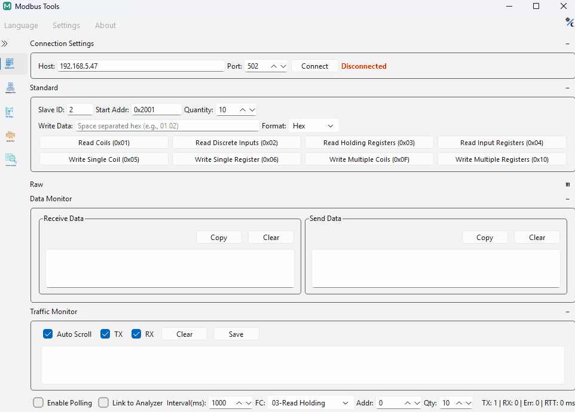

<div align="center">


# Modbus-Tools

**Portable Modbus protocol analyzer and diagnostic master utility built with C++20 and Qt 6.**

[](https://github.com/mingyucheng692/Modbus-Tools/actions/workflows/ci.yml)
[](LICENSE)

**English** | [简体中文](README_zh-CN.md) | [繁體中文](README_zh-TW.md)

<br/>



</div>

## Capabilities

| Subsystem | Specifications |
|:---|:---|
| **Modbus Master** | • **Transports**: Modbus TCP (Client), Modbus RTU, Modbus ASCII<br/>• **Function Codes**: `0x01`–`0x06`, `0x0F`, `0x10`<br/>• **Diagnostics**: Cyclic polling with exponential backoff, raw traffic monitor (Tx/Rx separation), line-level timing validation |
| **Protocol Analyzer** | • **Decomposition**: Heuristic ADU/PDU field inspection, CRC16/LRC validation, exception code breakdown<br/>• **Data Grid**: Multi-type decoding (`Int16/32`, `UInt16/32`, `Float32/64`) across 4-way byte orders (`ABCD`, `CDAB`, `BADC`, `DCBA`)<br/>• **Interoperability**: Real-time capture linkage, JSON register mapping import/export, CSV telemetry dump |
| **Signal Workbench** | • **Visual Frame Builder**: Interactive PDU assembler with C-array and Hex byte export<br/>• **IEEE 754 Converter**: Bidirectional Hex/Float/Integer translator with NaN/Inf/Denormal detection<br/>• **Raw Transports**: General-purpose TCP Client/Server, UDP socket, and COM/TTY serial monitors |
| **Runtime Architecture** | • **Deployment**: 100% portable (local `config.ini`, `logs/`, zero registry pollution)<br/>• **Concurrency**: Process-isolated sessions ("One Instance, One Session")<br/>• **Localization**: Runtime dynamic switching (EN / zh-CN / zh-TW) |

## Quick Start

### Prebuilt Binaries
Standalone portable binaries are available under [Releases](https://github.com/mingyucheng692/Modbus-Tools/releases):
- **Windows (x64)**: Portable archive (`.zip`)
- **Linux (x86_64, glibc 2.35+)**: Self-contained portable archive (`.tar.gz`, bundled Qt runtimes)

### Build from Source
Prerequisites: C++20 compiler, CMake 3.25+, Qt 6.6+ (`Core`, `Network`, `SerialPort`, `Widgets`).

```bash
git clone --recursive https://github.com/mingyucheng692/Modbus-Tools.git
cd Modbus-Tools
cmake -S . -B build -DCMAKE_BUILD_TYPE=Release
cmake --build build --config Release --parallel
```

Specify `-DCMAKE_PREFIX_PATH=<Qt install dir>` if Qt is not discoverable by CMake.
For generator selection (Ninja / Visual Studio), running the test suite, AddressSanitizer, and static analysis, see [CONTRIBUTING.md](CONTRIBUTING.md).

## Operational Boundaries & Safety

- **Master/Client Scope**: Implements active master/client operations (`TCP Client`, `RTU Master`, `ASCII Master`). Slave/server simulation is intentionally out of scope.
- **Physical Equipment Impact**: Write operations (`0x05`, `0x06`, `0x0F`, `0x10`) command connected physical devices directly. Operators must verify slave IDs, register addresses, and physical safety conditions prior to dispatch.
- **Safety Criticality**: Designed for engineering development, lab testing, and field commissioning. Not certified for safety-critical, fail-safe, or life-support control loops ([DISCLAIMER.md](DISCLAIMER.md)).
- **Concurrency & Storage**: Portable directory layout (`config.ini`, `logs/`, `update/`). Multi-instance execution uses process isolation with last-write-wins config persistence on exit.

## Documentation

- [User Guide](docs/user-guide.md) — Workflows, frame decoding, and operational procedures
- [Contributing Guide](CONTRIBUTING.md) — Toolchain setup, build matrix, and CI test policies
- [Architecture Decision Records (ADRs)](docs/adr/README.md) — Architectural invariants and design rationale
- [Disclaimer](DISCLAIMER.md) · [License](LICENSE)

## Third-Party Components & Attribution

Modbus-Tools builds upon the following open-source libraries:
- [Qt Framework](https://www.qt.io/) (LGPLv3) — GUI layer, event loop, and asynchronous I/O channels
- [spdlog](https://github.com/gabime/spdlog) & [{fmt}](https://github.com/fmtlib/fmt) (MIT) — High-performance structured logging backend
- [GoogleTest](https://github.com/google/googletest) (BSD-3-Clause) — Unit, integration, and fuzz test harness
