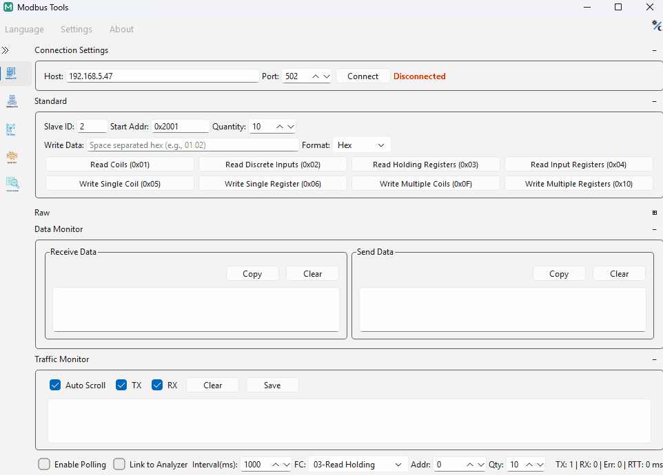

<div align="center">


# Modbus-Tools

**基于 C++20 与 Qt 6 构建的便携式 Modbus 协议分析与主站诊断工具。**

[](https://github.com/mingyucheng692/Modbus-Tools/actions/workflows/ci.yml)
[](LICENSE)

[English](README.md) | **简体中文** | [繁體中文](README_zh-TW.md)

<br/>



</div>

## 核心特性

| 子系统 | 技术规格与能力 |
|:---|:---|
| **Modbus 主站** | • **通信链路**：Modbus TCP (Client)、Modbus RTU、Modbus ASCII<br/>• **功能码支持**：`0x01`–`0x06`、`0x0F`、`0x10`<br/>• **诊断与监控**：周期轮询（指数阶梯退避）、原始收发流量分流监控 (Tx/Rx)、帧间隔静默时间判定 |
| **协议分析器** | • **报文解构**：启发式协议推断、ADU/PDU 字段拆解、CRC16/LRC 校验位检验、异常码分解<br/>• **寄存器表格**：多类型解码（`Int16/32`、`UInt16/32`、`Float32/64`），支持 4 种字节序（大端 `ABCD`、字交换 `CDAB`、字节交换 `BADC`、小端 `DCBA`）<br/>• **联动与交换**：活动调试会话实时捕获联动、JSON 格式寄存器配置导入导出、CSV 数据报表导出 |
| **信号辅助工具** | • **可视化报文构造器**：请求参数交互式组装、字段拆解、多格式（紧凑 Hex、空格 Hex、C 数组）复制导出<br/>• **IEEE 754 转换器**：双向十六进制/浮点/整型换算，支持 NaN / Infinity / 非规格化数识别<br/>• **底层链路调试**：通用 TCP 客户端/服务端、UDP 调试器及 COM/TTY 串口调试 |
| **运行时架构** | • **便携部署**：免安装绿色运行，配置 (`config.ini`)、日志 (`logs/`) 与暂存更新就近存储，不写入系统注册表<br/>• **并发模型**：“单实例单会话”进程级隔离<br/>• **国际化**：英文、简体中文与繁体中文运行时动态切换 |

## 快速上手

### 预编译可执行文件
免安装便携独立运行包可在 [Releases](https://github.com/mingyucheng692/Modbus-Tools/releases) 页面直接下载：
- **Windows (x64)**：便携压缩包 (`.zip`)
- **Linux (x86_64, glibc 2.35+)**：自包含便携运行包 (`.tar.gz`，内置 Qt 运行时)

### 从源码构建
环境要求：C++20 编译器、CMake 3.25+、Qt 6.6+ (`Core`, `Network`, `SerialPort`, `Widgets`)。

```bash
git clone --recursive https://github.com/mingyucheng692/Modbus-Tools.git
cd Modbus-Tools
cmake -S . -B build -DCMAKE_BUILD_TYPE=Release
cmake --build build --config Release --parallel
```

若 CMake 无法自动发现 Qt，请追加 `-DCMAKE_PREFIX_PATH=<Qt 安装目录>`。
关于生成器选择（Ninja / Visual Studio）、单元测试执行、AddressSanitizer 内存检查及静态分析，请参阅 [CONTRIBUTING.md](CONTRIBUTING.md)。

## 运行边界与安全规范

- **主站角色约束**：仅提供主动主站/客户端诊断能力，不支持从站/服务端仿真。
- **物理设备影响**：写操作（`0x05`、`0x06`、`0x0F`、`0x10`）直接下发指令控制物理受控端设备。操作人员须在下发前严格复核目标从站地址、寄存器偏移及设备安全联锁状态。
- **安全适用性**：专用于工程研发、实验室验证与现场排障。未经安全完整性等级 (SIL) 或工业安全认证，严禁作为人身安全或应急保护系统的控制回路（详见 [DISCLAIMER.md](DISCLAIMER.md)）。
- **并发与持久化**：采用便携式目录结构。多实例并发运行时各进程相互隔离，退出时对共享 `config.ini` 遵循末尾覆盖规则（Last-Write-Wins）。

## 文档指引

- [使用手册](docs/user-guide_zh-CN.md) — 任务导向操作指南、报文解构与诊断流程
- [开发者与贡献指南](CONTRIBUTING.md) — 编译选项、测试执行与 CI 门禁规范
- [架构决策记录 (ADR)](docs/adr/README.md) — 核心系统设计与架构红线
- [免责声明](DISCLAIMER.md) · [开源许可证](LICENSE)

## 第三方开源组件与技术栈

本工具基于以下工业级开源项目构建：
- [Qt Framework](https://www.qt.io/) (LGPLv3) — 图形界面、跨平台事件循环与网络/串口 I/O 通道
- [spdlog](https://github.com/gabime/spdlog) & [{fmt}](https://github.com/fmtlib/fmt) (MIT) — 高性能结构化异步日志引擎
- [GoogleTest](https://github.com/google/googletest) (BSD-3-Clause) — 单元测试、模拟对象与模糊测试套件
