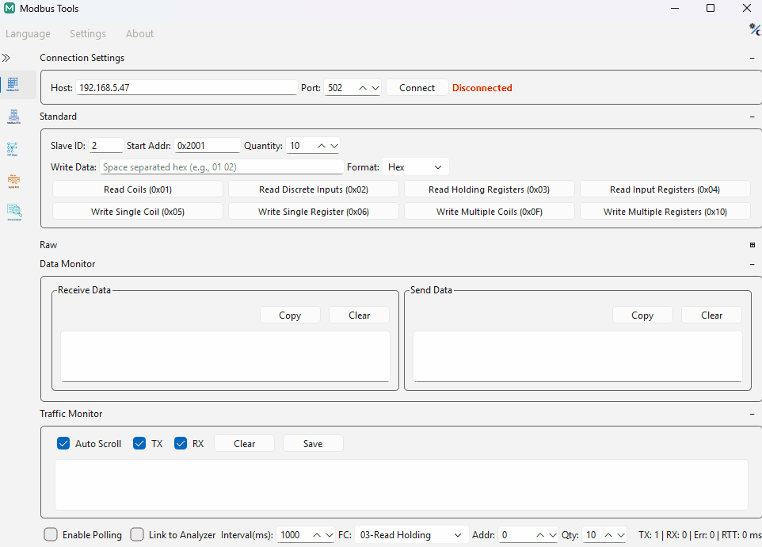

<div align="center">


# Modbus-Tools

**基於 C++20 與 Qt 6 建構的免安裝便攜式 Modbus 通訊協定分析與主站診斷工具。**

[](https://github.com/mingyucheng692/Modbus-Tools/actions/workflows/ci.yml)
[](LICENSE)

[English](README.md) | [简体中文](README_zh-CN.md) | **繁體中文**

<br/>



</div>

## 核心特性

| 子系統 | 技術規格與能力 |
|:---|:---|
| **Modbus 主站** | • **通訊鏈路**：Modbus TCP (Client)、Modbus RTU、Modbus ASCII<br/>• **功能碼支援**：`0x01`–`0x06`、`0x0F`、`0x10`<br/>• **診斷與監控**：週期輪詢（指數階梯退避）、原始收發流量分流監控 (Tx/Rx)、訊框間隔靜默時間判定 |
| **協定分析器** | • **訊框解構**：啟發式協定推斷、ADU/PDU 欄位拆解、CRC16/LRC 校驗位檢驗、異常碼分解<br/>• **暫存器表格**：多型態解碼（`Int16/32`、`UInt16/32`、`Float32/64`），支援 4 種位元組序（大端 `ABCD`、字交換 `CDAB`、位元組交換 `BADC`、小端 `DCBA`）<br/>• **連動與交換**：活動調試工作階段即時擷取連動、JSON 格式暫存器設定匯入匯出、CSV 資料報表匯出 |
| **訊號輔助工具** | • **視覺化報文建構器**：請求參數互動式組裝、欄位拆解、多格式（緊湊 Hex、空格 Hex、C 陣列）複製匯出<br/>• **IEEE 754 轉換器**：雙向十六進位/浮點/整數換算，支援 NaN / Infinity / 非正規化數識別<br/>• **底層鏈路調試**：通用 TCP 用戶端/伺服端、UDP 調試器及 COM/TTY 序列埠調試 |
| **執行階段架構** | • **便攜部署**：免安裝綠色執行，設定檔 (`config.ini`)、日誌 (`logs/`) 與暫存更新就近儲存，不寫入系統登錄檔<br/>• **並行模型**：「單執行個體單工作階段」處理程序級隔離<br/>• **國際化**：英文、簡體中文與繁體中文執行階段動態切換 |

## 快速上手

### 預編譯執行檔
免安裝便攜獨立執行套件可直接於 [Releases](https://github.com/mingyucheng692/Modbus-Tools/releases) 頁面下載：
- **Windows (x64)**：便攜壓縮包 (`.zip`)
- **Linux (x86_64, glibc 2.35+)**：自包含便攜執行套件 (`.tar.gz`，內建 Qt 執行階段)

### 從原始碼構建
環境需求：C++20 編譯器、CMake 3.25+、Qt 6.6+ (`Core`, `Network`, `SerialPort`, `Widgets`)。

```bash
git clone --recursive https://github.com/mingyucheng692/Modbus-Tools.git
cd Modbus-Tools

# 設定與編譯（若 Qt 未加入 PATH，需顯式指定 -DCMAKE_PREFIX_PATH）
cmake -S . -B build -G Ninja -DCMAKE_BUILD_TYPE=Release
cmake --build build --parallel
```

關於開發者專案設定、單元測試、AddressSanitizer 記憶體檢查及靜態分析，請參閱 [CONTRIBUTING.md](CONTRIBUTING.md)。

## 運行邊界與安全規範

- **主站角色約束**：僅提供主動主站/用戶端診斷能力，不包含從站/伺服端模擬。
- **實體設備影響**：寫操作（`0x05`、`0x06`、`0x0F`、`0x10`）直接下發指令控制實體受控端設備。操作人員須在下發前嚴格複核目標從站位址、暫存器偏移及設備安全連鎖狀態。
- **安全適用性**：專用於工程研發、實驗室驗證與現場排障。未獲安全完整性等級 (SIL) 或工業安全認證，嚴禁作為人身安全或緊急保護系統的控制迴路（詳見 [DISCLAIMER.md](DISCLAIMER.md)）。
- **並行與持久化**：採用便攜式目錄結構。多個執行個體並行運作時各處理程序相互隔離，結束時對共享 `config.ini` 依循末尾覆寫規則（Last-Write-Wins）。

## 文件指引

- [使用手冊](docs/user-guide_zh-TW.md) — 任務導向操作指南、訊框解構與診斷流程
- [開發者與貢獻指南](CONTRIBUTING.md) — 編譯選項、測試執行與 CI 門禁規範
- [架構決策記錄 (ADR)](docs/adr/README.md) — 核心系統設計與架構紅線
- [免責聲明](DISCLAIMER.md) · [開源授權條款](LICENSE)

## 第三方開源組件與技術堆疊

本工具基於以下工業級開源專案建構：
- [Qt Framework](https://www.qt.io/) (LGPLv3) — 圖形介面、跨平台事件迴圈與網路/序列埠 I/O 通道
- [spdlog](https://github.com/gabime/spdlog) & [{fmt}](https://github.com/fmtlib/fmt) (MIT) — 高效能結構化非同步日誌引擎
- [GoogleTest](https://github.com/google/googletest) (BSD-3-Clause) — 單元測試、模擬物件與模糊測試套件
