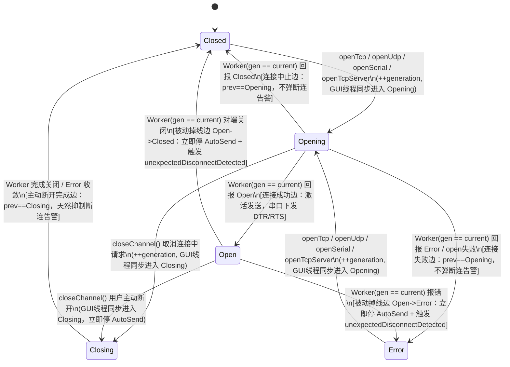

# Task 6: NetworkPage / SerialPage 架构收敛、零布尔边驱动状态机、命名统一与跨页底座清扫计划

> **目标**：以 Task 5 建成的 `ModbusPage` 零缺陷架构为视觉与工程标杆，遵循 **YAGNI**、**DRY** 与 **Ousterhout 深模块**原则，完成 `NetworkDebuggerView` / `SerialDebuggerView` 向 `NetworkPage` / `SerialPage` 的全面重构：根治并发代际竞态、多处散乱状态机与双轨分裂、HEX 静默发错字节、过滤误停统计与 AutoSend 状态越权等真实缺陷；废除浅继承基类 `GenericChannelViewBase`，收敛出具备**「零辅助布尔旗标（纯状态转移边驱动）+ 编译期转移表校验 + 声明式 `SessionUiSnapshot` 投影」**且 100% 可无头单测的深模块 `ChannelSessionController`；落实 **方案 A** 彻底移除 `SettingsService` 历史迁移引擎，全链路短名化（`network/*`、`serial/*`）；完成 UI 导航栏 4 字视觉对齐与强防呆交互；同步收口 Task 5 延期至本阶段的 4 项跨页共享底座债。
> **前置基线**：Task 5（批次 1~7 + 尾账 T5-15/T5-22/T5-23）闭环完成、`qt_safety_check.py` 0 违规、`ctest` 全绿。
> **已拍板产品与工程决策**：
> 1. **导航栏命名**：英文 `Network` / `Serial`；简体中文 `网络调试` / `串口调试`（4 字与 `报文分析` / `实用工具` 视觉对齐）；繁体中文 `網路除錯` / `串口除錯`。
> 2. **未连接发送交互（强防呆）**：与 `ModbusPage` 行为严格一致——未连接时置灰 `Send` 按钮与 `Auto Send` 复选框并挂载 Tooltip（如 *"Connect first to send data"*），文本框保持可编辑以便预先整理报文；HEX 校验失败采用输入框边框变红 + 底部实时行内错误提示，杜绝误触与顶栏跳变。
> 3. **INI 配置精简（方案 A）**：彻底移除 `SettingsService` 内部陈旧的 `kKeyPrefixMigrations` 迁移引擎、`migrateLegacyKeys()` 及 `keysToRemove_`（净删约 180 行历史包袱代码）；全面采用 `network/*` 与 `serial/*` 短名空间，新配置轻装上阵。
> 4. **零布尔边驱动有限状态机 + 声明式 `SessionUiSnapshot` 投影（SSOT）**：
>    - **`ChannelSessionController` 统一纳管双 Worker**：按需懒启动 `ChannelOperationWorker`（TCP Client / UDP / Serial）与 `ServerChannelWorker`（TCP Server，`SerialPage` 永不触发创建），使 `NetworkPage` 彻底告别手写 `QThread`、`serverWorker_`、`serverGeneration_` 及双状态机分裂；
>    - **零辅助生命周期布尔旗标（纯状态边驱动）**：彻底消灭 `isConnected_`、`manualDisconnectRequested_`、`suppressDisconnectAlert_` 三个辅助布尔变量。主动断开在 GUI 线程同步走 **`Open → Closing → Closed`** 转移路径；对端掉线/硬件拔出直接走 **`Open → Closed / Error`** 转移边；连接失败走 **`Opening → Error / Closed`** 转移边。仅凭状态转移边 `(prevState == Open && (newState == Closed || newState == Error))` 即可在数学上 100% 无歧义判定被动异常断连；
>    - **编译期状态转移表校验 + 声明式 `SessionUiSnapshot` 投影**：内置 `static constexpr std::array kValidTransitions` 校验合法状态边，并每次状态或服务端目标客户端变化时计算纯值快照 `SessionUiSnapshot`（含 `state`、`stateText`、`protocolSelectorEnabled`、`serialControlLinesEnabled`、`sendControlsEnabled`、`sendDisabledTooltip`），使 `NetworkPage` 与 `SerialPage` 的状态响应退化为**零 `if-else`、零 `switch` 的 4 行纯赋值**；
>    - **状态与错误严格正交**：Worker 保证所有同步/异步打开失败均收敛至终态 `ChannelState::Error`；View 的 `onErrorOccurred` 严格只向 `ByteMonitorWidget` 打印错误日志，严禁在错误回调中夹带 UI 状态回滚补丁。
> 5. **UI 优雅布局与对 `ModbusPage` 零牵连**：
>    - **零布局抖动错误反馈**：废弃独立的顶层 `Status Banner` 控件，输入校验错误由 `GenericInputWidget` 行内红字承载，异常断连由中央监控日志承载；
>    - **单一职责数据流监控**：`ByteMonitorWidget` 严守数据流观察器职责，不塞入任何硬件专用插槽；
>    - **硬件引脚归位串口区**：串口 `DTR/RTS` 紧凑放置在 `SerialPage` 顶部串口连接区域右侧，通过 `CollapsibleSection` 联动 `SerialConnectionWidget` 同步折叠与展开；
>    - **消除双重滚动**：移除外层 `QScrollArea` 包装，由内部监控日志与输入框自适应伸缩；
>    - **对 `ModbusPage` 零业务影响**：仅共享复用 `CompactStackedWidget.h` 及共享底座死码清理，完全不触碰 `ModbusPagePresenter` / `ModbusSessionPresenter` / `ConnectionStateMachine`。
> **物理范围**：`core/Config.h`、`core/CMakeLists.txt`、`core/common/{SettingsKeys.h,TrafficStats.h}`、`core/modbus/telemetry/TrafficMetrics.h`（迁出）、`infra/config/SettingsService.{h,cpp}`、`infra/io/{ChannelOperationWorker,ServerChannelWorker}.{h,cpp}`、`ui/CMakeLists.txt`、`ui/MainWindow.cpp`、`ui/shell/MainWindowPageBuilder.{h,cpp}`、`ui/common/FileExporter.{h,cpp}`、`ui/application/ChannelSessionController.{h,cpp}`、`ui/views/{GenericChannelViewBase,ChannelController}.{h,cpp}`（演进/移除）、`ui/views/modbus/ModbusPage.cpp`（复用 `CompactStackedWidget`）、`ui/views/network/NetworkPage.{h,cpp}`、`ui/views/serial/SerialPage.{h,cpp}`、`ui/widgets/{BaseConnectionWidget,NetworkConnectionWidget,TcpConnectionWidget,UdpConnectionWidget,SerialConnectionWidget,ServerClientPanel,ByteMonitorWidget,GenericInputWidget,CompactStackedWidget}.{h,cpp}`、`ui/widgets/modbus/ModbusTelemetryWidget.cpp`（对齐 `FileExporter` 新签名）、`ui/i18n/*.ts`、`docs/adr/README.md`、`tests/**`。
> **总计**：4 个原子批次 · 12 项粒度均衡任务（每项严格控制在 80~300 LOC，零巨型任务、零微碎任务、零跨批返工），每批均可独立编译并通过全部门禁。

---

## 一、零布尔边驱动有限状态机（Edge-Driven Session FSM）与 `SessionUiSnapshot` 规范

### 1.1 编译期合法状态转移图（零辅助布尔旗标，纯靠转移边区分语义）



> **数学不变量**：
> - **主动断开**：必经 `Open → Closing → Closed`（当 `Closed` 到达时 `prevState == Closing`）；
> - **连接失败**：必经 `Opening → Error / Closed`（当终态到达时 `prevState == Opening`）；
> - **被动掉线**：唯一直接跨越 `Open → Closed` 或 `Open → Error` 的转移边（`prevState == Open`）。
> - 因此：**`isPassiveDisconnect = (prevState == ChannelState::Open) && (newState == ChannelState::Closed || newState == ChannelState::Error)`**，全链路 **0 辅助布尔变量**。

### 1.2 声明式 `SessionUiSnapshot` 投影表（View 层 4 行纯赋值，零分支）

`ChannelSessionController` 每次状态迁移或服务端目标客户端变更（`setServerTargetState(hasTargets, broadcastMode)`）时，由纯函数计算并发射 `snapshotChanged(const SessionUiSnapshot& snap)`：

```cpp
struct SessionUiSnapshot {
    io::ChannelState state = io::ChannelState::Closed;
    QString stateText;                      // 按 ChannelRole 格式化 (Connected / Listening / Bound / Open / ...)
    bool stateChanged = false;              // 本次快照是否由 ChannelState 跃迁触发（用于决定是否打印 State changed 日志）
    bool protocolSelectorEnabled = true;    // state == Closed || state == Error
    bool serialControlLinesEnabled = false; // state == Open && role == Serial
    bool sendControlsEnabled = false;       // state == Open && (role != TcpServer || serverHasTargets)
    QString sendDisabledTooltip;            // 未连接 / 连接中 / 断开中 / 服务端无目标客户端 对应的精确提示文案
};
```

| 权威状态 `state` | `role` 与附加条件 | `protocolSelectorEnabled` | `BaseConnectionWidget::applyChannelState` | `serialControlLinesEnabled` | `sendControlsEnabled` | `sendDisabledTooltip` | `AutoSend` 定时器 |
| :--- | :--- | :---: | :---: | :---: | :---: | :--- | :---: |
| **`Closed` / `Error`** | 任意模式 | `true` | `Disconnected` | `false` | `false` | `tr("Connect first to send data")` | **强制停止** |
| **`Opening`** | 任意模式 | `false` | `Connecting` | `false` | `false` | `tr("Connecting...")` | **强制停止** |
| **`Closing`** | 任意模式 | `false` | `Disconnecting` | `false` | `false` | `tr("Disconnecting...")` | **强制停止** |
| **`Open`** | `TcpClient` / `Udp` / `Serial` | `false` | `Connected` / `Bound` | `role == Serial` | **`true`** | `""` | 允许运行 |
| **`Open`** | `TcpServer` (有目标客户端) | `false` | `Listening` | `false` | **`true`** | `""` | 允许运行 |
| **`Open`** | `TcpServer` (无客户端或未勾选) | `false` | `Listening` | `false` | **`false`** | 广播无客户端：`tr("No connected clients")`<br>单播未选：`tr("Select at least one client")` | **自动停止** |

---

## 二、子域审查与收敛总表（粒度重平衡：每项 80~300 LOC，零巨型任务、零微任务）

| 批次与阶段 | 范围与核心重点 | `[B]` | `[S]` | `[D]` | 任务编号 | 核心收敛动作与粒度控制 |
| :--- | :--- | :---: | :---: | :---: | :--- | :--- |
| **批次 1：P0 底层与共享底座止血** | `ServerChannelWorker`、`ChannelOperationWorker`、`ByteMonitorWidget`、`GenericInputWidget`、`TrafficStats`、`FileExporter`、`BaseConnectionWidget`、`CompactStackedWidget` | 3 | 1 | 0 | `T6-01` ~ `T6-04` | `T6-01` Worker 代际/终态保底 (~90 行)；`T6-02` ByteMonitor 统计脱钩/暗黑调色 (~80 行)；`T6-03` GenericInput 严格 HEX/强防呆/修 `onAutoSendToggled` (~120 行)；`T6-04` 共享底座 4 项收口 + `applyChannelState` + 抽离 `CompactStackedWidget.h` (~120 行) |
| **批次 2：P1 零布尔 FSM 与两页逐页收敛** | `ChannelSessionController`、`ChannelSessionControllerTest`、`SerialDebuggerView`、`NetworkDebuggerView`、`ServerClientPanel`、`GenericChannelViewBase` | 0 | 3 | 0 | `T6-05` ~ `T6-07` | `T6-05` 建立 `ChannelSessionController` 并**同批完成无头单测 `ChannelSessionControllerTest`** 锁定 FSM (~260+180 行)；`T6-06` 串口页一步到位接入 FSM + 顶部 `Control` 同步折叠布局 (~140 行)；`T6-07` 网络页一步到位接入 FSM + `Protocol:` 折叠布局 + `ServerClientPanel` 目标感知 + 删除 `GenericChannelViewBase` (~280 行) |
| **批次 3：P1 命名短名化、方案 A 与去外层滚动条** | `NetworkPage`、`SerialPage`、`MainWindow`、`MainWindowPageBuilder`、`SettingsKeys`、`SettingsService`、`.ts` | 0 | 3 | 0 | `T6-08` ~ `T6-10` | `T6-08` 类/文件/枚举/导航栏短名化（4 字中文对齐）与 `.ts` 迁移（纯重命名，0 逻辑混杂）；`T6-09` 方案 A 彻底删除 `SettingsService` 迁移引擎并切换 `network/*`、`serial/*`（净删 ~180 行）；`T6-10` 移除 `MainWindowPageBuilder` 外层 `QScrollArea` 并净化 View 层 `spdlog` (~60 行) |
| **批次 4：P3 回归测试与全量门禁闭环** | `tests/unit/ui/**`、`docs/adr/README.md`、`ui/i18n/*.ts` | 0 | 0 | 2 | `T6-11` ~ `T6-12` | `T6-11` 重命名并扩充 `NetworkPageTest` / `SerialPageTest` 回归矩阵 (~220 行)；`T6-12` 同步 ADR 0004 文档、复杂度复核与全量四道门禁闭环 |

---

## 三、执行批次与依赖流转

```text
  [批次 1: T6-01 ~ T6-04] (P0 底层与共享底座止血：Worker 终态保底 + ByteMonitor/GenericInput 修复 + 共享底座/CompactStackedWidget)
           │
           ▼  (底层 Worker、通用控件与共享连接底座 100% 就绪)
  [批次 2: T6-05 ~ T6-07] (P1 状态机先行与逐页一步到位：T6-05 Controller+无头单测 ──► T6-06 串口页收敛 ──► T6-07 网络页收敛+删旧基类)
           │
           ▼  (先无头锁定 FSM，再按页独立收敛架构与折叠布局，避免巨型任务与跨批返工)
  [批次 3: T6-08 ~ T6-10] (P1 纯粹重命名与配置清扫：T6-08 NetworkPage/SerialPage 短名化 ──► T6-09 方案 A 删迁移引擎 ──► T6-10 去 QScrollArea 与日志净化)
           │
           ▼  (全仓符号、INI 短名键、翻译上下文与无双重滚动布局彻底定型)
  [批次 4: T6-11 ~ T6-12] (P3 页面级回归测试补齐、ADR 0004 文档同步与全量四道门禁闭环)
```

> **工程红线与约束守则**：
> 1. **零跨页侵入与对 `ModbusPage` 零牵连**：严禁触碰 `FrameAnalyzerView`、`UtilitiesView`、`ModbusFrameBuilderWidget`、`Ieee754ConverterWidget`、`ModbusDataHelper`、`AnalyzerExporter`、`FrameDecodedTableView`、`RegisterTypeDelegate`，以及 `ModbusPagePresenter`、`ModbusSessionPresenter`、`ConnectionStateMachine`。
> 2. **共享连接控件契约**：严禁向 `BaseConnectionWidget` / `TcpConnectionWidget` / `UdpConnectionWidget` / `SerialConnectionWidget` 注入任何特定页面标识分支。
> 3. **无异常与并发安全**：全局 `-fno-exceptions`；跨线程调用强制 `Qt::QueuedConnection` 强类型仿函数；单测严格零 `sleep()`、禁读系统剪贴板。
> 4. **质量门禁**：每批次必须依次通过静态检查、安全门禁、Release 编译和自动化单测。

---

## 四、任务详情清单

### 批次 1：P0 底层 Worker、通用控件止血与共享底座收口

> **本批范围**：`infra/io/{ServerChannelWorker,ChannelOperationWorker}.{h,cpp}`、`ui/widgets/{ByteMonitorWidget,GenericInputWidget,BaseConnectionWidget,NetworkConnectionWidget,TcpConnectionWidget,SerialConnectionWidget,CompactStackedWidget}.{h,cpp}`、`ui/views/modbus/ModbusPage.cpp`、`core/common/TrafficStats.h`（迁自 `core/modbus/telemetry/TrafficMetrics.h`）、`core/CMakeLists.txt`、`ui/common/FileExporter.{h,cpp}`、`ui/widgets/modbus/ModbusTelemetryWidget.cpp`、`tests/**`。

- [ ] **T6-01 [B] `ServerChannelWorker` 与 `ChannelOperationWorker` 信号代际统一、同步失败终态保底与接口正名**
  - **位置**：`infra/io/ServerChannelWorker.{h,cpp}`、`infra/io/ChannelOperationWorker.{h,cpp}`
  - **实证**：`ChannelOperationWorker` 残留 0 使用的 `bytesQueued` 信号，且 `open*()` 若底层返回 `false` 而未触发 `ChannelState::Error` 时不发终态信号，导致上层 UI 卡在 `Connecting`；`ServerChannelWorker` 缺少代际 `generation`，且 `closeAllClients()` 语义实为停服；两文件残留未用头文件。
  - **改造方案**：
    1. `ChannelOperationWorker`：移除无用的 `bytesQueued(qint64)` 信号；统一 `stateChanged(ChannelState state, quint64 generation = 0)` 为唯一状态信号；在 `openTcp`/`openSerial`/`openUdp` 中若 `!channel_->open()`，除发射 `channelErrorOccurred` 外，若 `channel_->state() != ChannelState::Error` 则保底发射 `emit stateChanged(ChannelState::Error, channelGeneration_)`，确保任何打开失败必有终态回调。
    2. `ServerChannelWorker`：`openTcpServer(listenIp, port, maxClients, generation = 0)` 记录 `serverGeneration_`，统一发射 `stateChanged(ChannelState state, quint64 generation = 0)`（监听失败时发射 `ChannelState::Error` + `serverGeneration_`）；将 `closeAllClients()` 正名为 `stopServer()`；新增 `disconnectAllClients()`（仅断开现有全部客户端，保持监听端口继续运行）。
    3. 清理两个 Worker 中未使用的头文件（`core/Config.h`、`QThread`、`spdlog` 等）。
  - **验证**：更新 `ServerChannelWorkerTest` 和 `ChannelOperationWorkerTest`，验证代际透传、失败终态保底、`stopServer` 停监听、`disconnectAllClients` 踢客户端但保持监听。

- [ ] **T6-02 [B] 修复 `ByteMonitorWidget` 统计口径 Bug、暗黑主题适配与去死码（坚守观察器单一职责）**
  - **位置**：`ui/widgets/ByteMonitorWidget.{h,cpp}`
  - **实证**：① `enqueueTraffic()` 提前根据复选框过滤跳出，导致隐藏 TX/RX 时错误停止统计底层真实字节数；② 缺少暗黑模式高对比度调色；③ `formatTimestamp()`、`appendLogLine()` 属于 0 调用死代码；④ `onCopyClicked()` 未发射可测信号。
  - **改造方案**：
    1. `enqueueTraffic()` 中空数据直接返回；**先执行 `stats_.update(...)` 刷新统计数值**，再根据 `showTxCheck_`/`showRxCheck_` 决定是否向日志视图插入渲染行。
    2. 动态检测窗口明度，在亮暗主题间自适应切换高对比度颜色（TX/RX 标签及十六进制着色）；在 `changeEvent(QEvent::PaletteChange)` 同步重刷样式。
    3. 删除死函数 `formatTimestamp()` 与 `appendLogLine()`；复制成功后发射 `logCopied(const QString& text)` 信号（支持无头测试）。
    4. 坚守通用观察器职责，不增加任何硬件专用插槽。
  - **验证**：扩展 `ByteMonitorWidgetTest`，覆盖隐藏 TX/RX 时统计数据仍准确增加、暗黑调色、`logCopied` 信号测试。

- [ ] **T6-03 [B] 修复 `GenericInputWidget` 严格 HEX 校验、强防呆控制、修复 `onAutoSendToggled` 状态越权与禁恢复 `autoSend`**
  - **位置**：`ui/widgets/GenericInputWidget.{h,cpp}`
  - **实证**：① HEX 模式使用 `QByteArray::fromHex()` 静默忽略非法字符或奇数位，导致工控报文错漏字节；② `onAutoSendToggled` 第 313 行硬编码 `sendBtn_->setEnabled(true)`，越权破坏外部防呆禁用态；③ `loadSettings` 恢复了 `autoSend = true`，存在冷启动误发安全风险；④ 单行控制栏在 720px 窄屏下挤压溢出。
  - **改造方案**：
    1. 新增严格纯度校验接口 `[[nodiscard]] bool tryBuildPayload(QByteArray* out, QString* errorOut = nullptr) const`：HEX 模式使用严格清洗校验（必须偶数位且仅含十六进制字符），非法时设置文本框红色高亮并在底部行内显示错误原因，绝不静默发送。
    2. 新增 `void setSendControlsEnabled(bool enabled, const QString& disabledTooltip = {})`：维护 `bool sendControlsEnabled_`；未连接时置灰 `Send` 按钮和 `Auto Send` 选框（并取消勾选/禁用间隔框）及挂载 Tooltip，**保留文本输入框自由可编辑**；修复 `onAutoSendToggled()`，移除硬编码的 `sendBtn_->setEnabled(true)`，使其严格受控于 `sendControlsEnabled_`。
    3. 移除 `autoSend` 属性的持久化恢复（配置中忽略该键，冷启动恒为未激活）。
    4. 增加 `Ctrl+Enter` 快捷发送响应（仅当 `sendControlsEnabled_` 为真时触发）；控制面板采用紧凑的两行响应式布局，保障 720px 窄屏无水平滚动与挤压。
  - **验证**：扩展 `GenericInputWidgetTest`，覆盖非法 HEX 拦截与行内错误提示、强防呆置灰与切换 AutoSend 不越权点亮 Send、`autoSend` 冷启动安全性、`Ctrl+Enter` 快捷键。

- [ ] **T6-04 [S] 收口共享底座（`TrafficStats` 迁出、`FileExporter` 瘦身、`BaseConnectionWidget::applyChannelState`、`CompactStackedWidget` 抽取）**
  - **位置**：`core/modbus/telemetry/TrafficMetrics.h` → `core/common/TrafficStats.h`、`ui/common/FileExporter.{h,cpp}`、`ui/widgets/{BaseConnectionWidget,NetworkConnectionWidget,TcpConnectionWidget,SerialConnectionWidget}.{h,cpp}`、`ui/widgets/CompactStackedWidget.h`（新增）、`ui/views/modbus/ModbusPage.cpp`、相关测试
  - **实证**：`TrafficMetrics.h` 领域无关但放在 Modbus 目录迫使通用类反向引用；`FileExporter` 的 `append = true` 为 0 调用死代码；`BaseConnectionWidget::isConnected_` 与 `DisplayState::TransportConnected` 生产代码 0 调用；`ChannelState` 到 `DisplayState` 的 15 行 `switch` 在视图层重复写了 3 遍；`ModbusPage.cpp` 匿名命名空间中的 18 行 `CompactStackedWidget` 需供网络页共享复用。
  - **改造方案**：
    1. 将 `TrafficMetrics.h` 迁至 `core/common/TrafficStats.h`，命名空间 `core::common`，更新 `core/CMakeLists.txt`、`ByteMonitorWidget.h` 与测试。
    2. 精简 `FileExporter::exportLinesToFile`，删除 0 调用的 `exportAppend()` 与 `bool append` 参数，统一采用原子安全写入。
    3. 清除 `BaseConnectionWidget` 中死变量 `isConnected_` 与死状态 `TransportConnected`，同步清理 `TcpConnectionWidget` / `SerialConnectionWidget` 对应空分支；将 `connectedState()` 提升为 `BaseConnectionWidget` 的 `protected virtual DisplayState connectedState() const`（默认返回 `DisplayState::Connected`），并新增 `void applyChannelState(io::ChannelState state)`。
    4. 将 `CompactStackedWidget` 提取为 header-only 共享头文件 `ui/widgets/CompactStackedWidget.h`（~25 行），`ModbusPage.cpp` 改为直接 `#include` 复用。
  - **验证**：`TrafficStatsTest`、`FileExporterTest`、`ConnectionWidgetsTest`、`ModbusPageTest` 均编译并运行通过。

---

### 批次 2：P1 零布尔边驱动 FSM 深模块与两页视图逐页收敛（消除巨型任务与跨批返工）

> **本批范围**：`ui/application/ChannelSessionController.{h,cpp}`（新增）、`tests/unit/ui/ChannelSessionControllerTest.cpp`（新增）、`ui/views/serial/SerialDebuggerView.{h,cpp}`、`ui/views/network/NetworkDebuggerView.{h,cpp}`、`ui/widgets/ServerClientPanel.{h,cpp}`、`ui/views/{GenericChannelViewBase,ChannelController}.{h,cpp}`（移除）、`ui/CMakeLists.txt`、`tests/CMakeLists.txt`。

- [x] **T6-05 [S] 建立零布尔边驱动 FSM 深模块 `ChannelSessionController` 及纯无头单测 `ChannelSessionControllerTest`（状态机先行闭环）**
  - **位置**：`ui/application/ChannelSessionController.{h,cpp}`（新增）、`tests/unit/ui/ChannelSessionControllerTest.cpp`（加入 `TEST_QT_CORE_SOURCES`）、`ui/CMakeLists.txt`、`tests/CMakeLists.txt`
  - **改造方案**：
    1. 在 `ui/application/` 实现深模块 `ChannelSessionController`（继承 `QObject`，零 `QWidget` 依赖）：
       - **双 Worker 按需懒启动**：内部按需懒启动 `ChannelOperationWorker`（首次调 `openTcp` / `openUdp` / `openSerial` 时创建）与 `ServerChannelWorker`（首次调 `openTcpServer` 时创建，`SerialPage` 永不创建，0 闲置线程开销）。
       - **编译期状态转移表与零布尔边驱动 FSM**：
         - 内置 `static constexpr std::array<Transition, 11> kValidTransitions` 校验 `(from, to)` 合法性；
         - 调用 `open*()` 时：自增 `generation_`，记录 `role_`，**在 GUI 线程立即执行 `transitionTo(ChannelState::Opening)`** 并向对应 Worker 派发连接请求；
         - 调用 `closeChannel()` 时：立即停止 AutoSend，若当前处于 `Open` 或 `Opening` 则**在 GUI 线程立即执行 `transitionTo(ChannelState::Closing)`** 并向活动 Worker 派发 `close()` / `stopServer()`；
         - 收到 Worker 状态回调（通过 `generation == generation_` 校验）：执行 `transitionTo(nextState)`。**纯靠转移边 `prevState == ChannelState::Open && (nextState == ChannelState::Closed || nextState == ChannelState::Error)` 判定被动异常断连**并发射 `unexpectedDisconnectDetected()`，全类 **0 辅助生命周期布尔变量**。
       - **声明式 `SessionUiSnapshot` 投影与 AutoSend 闭环**：
         - 提供 `setRole(ChannelRole role)` 与 `setServerTargetState(bool hasTargetClients, bool broadcastMode)`；
         - 每次状态转移或服务端目标客户端变化时，由纯函数计算 `SessionUiSnapshot` 并发射 `snapshotChanged(const SessionUiSnapshot&)`；
         - 当 `snap.sendControlsEnabled` 为 `false` 时拒绝启动 `startAutoSend()`，并在状态离开 `Open` 或服务端目标客户端变空时自动停止 `autoSendTimer_` 并发射 `autoSendStateChanged(false)`。
       - **内联错误与状态格式化 + 安全释放**：提供 `static QString formatChannelError(io::ChannelErrorCode code, const QString& detail)` 与 `static QString formatChannelState(io::ChannelState state, ChannelRole role)`；析构复用 `core::common::ThreadGuard::stopThread(thread.get(), 1000)`。
    2. **同批完成纯无头单测 `ChannelSessionControllerTest`**（在不触碰任何 View 的前提下先行验证 FSM）：全覆盖 1.1 节 11 条状态转移边（`Open -> Closing -> Closed` 主动断开不告警、`Open -> Error` 与 `Open -> Closed` 被动掉线告警、`Opening -> Error` 连接失败不告警、过期代际丢弃、双 Worker 懒启动）及 1.2 节 `SessionUiSnapshot` 所有字段与 Tooltip 断言。
  - **验证**：`ctest -R ChannelSessionControllerTest` 在纯 `QCoreApplication` 下全绿，零 `sleep()`。

- [x] **T6-06 [S] 串口页一步到位收敛：脱离 `GenericChannelViewBase`、接入 4 行 `SessionUiSnapshot` 绑定与顶部 `Control` 同步折叠布局**
  - **位置**：`ui/views/serial/SerialDebuggerView.{h,cpp}`
  - **改造方案**：
    1. `SerialDebuggerView` 直接继承 `QWidget`，组合持有 `ui::application::ChannelSessionController sessionCtrl_`；彻底删除 `isConnected_`、`connectionGeneration_`、`manualDisconnectRequested_` 与 `startWorker()`（改由 `sessionCtrl_` 懒启动）。
    2. `onSessionSnapshotChanged(const SessionUiSnapshot& snap)` 采用 **4 行零分支纯赋值**（`connectionWidget_->applyChannelState(snap.state)`、`dtrCheck_->setEnabled(snap.serialControlLinesEnabled)`、`rtsCheck_->setEnabled(snap.serialControlLinesEnabled)`、`inputWidget_->setSendControlsEnabled(snap.sendControlsEnabled, snap.sendDisabledTooltip)`）；连接进入 `Open` 时自动下发当前 DTR/RTS 电平。
    3. **顶部连接栏响应式布局一步到位**：将 `dtrCheck_` / `rtsCheck_` 装入右侧 `CollapsibleSection(collapsible=false, title=tr("Control"))`，订阅 `connectionWidget_->sectionExpandedChanged` 同步折叠/展开，顶边对齐无悬空，720px 窄屏自适应。
  - **验证**：`SerialDebuggerViewTest` 编译并运行全绿。

- [x] **T6-07 [S] 网络页一步到位收敛：扩展 `ServerClientPanel` 目标感知、接入 `ChannelSessionController`、顶部 `Protocol:` 同步折叠布局并彻底删除 `GenericChannelViewBase`**
  - **位置**：`ui/widgets/ServerClientPanel.{h,cpp}`、`ui/views/network/NetworkDebuggerView.{h,cpp}`、`ui/views/{GenericChannelViewBase,ChannelController}.{h,cpp}`（删除）、`tests/unit/ui/ChannelControllerTest.cpp`（删除，已被 `ChannelSessionControllerTest` 超集替代）、`ui/CMakeLists.txt`、`tests/CMakeLists.txt`
  - **改造方案**：
    1. `ServerClientPanel` 新增 `targetSelectionChanged(bool hasTargets, bool broadcastEnabled)` 信号（在客户端增删、勾选变化或广播切换时触发）及 `hasTargetClients()` 查询接口。
    2. `NetworkDebuggerView` 直接继承 `QWidget`，组合持有 `ChannelSessionController sessionCtrl_`；**彻底删除** `isConnected_`、`connectionGeneration_`、`suppressDisconnectAlert_`、`manualDisconnectRequested_`、`computeTcpStateTransition`、`serverThread_`、`serverWorker_`、`startServerWorker()`、`stopServerWorker()`。
    3. `onSessionSnapshotChanged(const SessionUiSnapshot& snap)` 退化为 **零分支纯赋值**（更新 `protocolCombo_->setEnabled`、`activeConnectionWidget()->applyChannelState(snap.state)`、`inputWidget_->setSendControlsEnabled(snap.sendControlsEnabled, snap.sendDisabledTooltip)`）；所有连接/断开/监听/踢客户端按钮槽简化为向 `sessionCtrl_` 的 1 行委托；`onErrorOccurred` 仅打印错误日志。
    4. **顶部 `Protocol:` 折叠卡片布局一步到位**：复刻 `ModbusPage::setupConnectionBar()` 范式，左侧 `CollapsibleSection(collapsible=false, title=tr("Protocol:"))` 包裹 `protocolCombo_`，右侧用 `CompactStackedWidget` 包裹三协议卡片并联动同步折叠。
    5. 此时 `GenericChannelViewBase.{h,cpp}` 与旧 `ChannelController.{h,cpp}` 已 0 引用，从源码树与 `CMakeLists.txt` 彻底删除。
  - **验证**：全仓 `git grep "GenericChannelViewBase"` 0 残留，`NetworkDebuggerViewTest` 全绿。

---

### 批次 3：P1 命名短名化、方案 A 配置清扫与外层滚动条清理

> **本批范围**：`ui/views/network/NetworkPage.{h,cpp}`、`ui/views/serial/SerialPage.{h,cpp}`、`ui/shell/MainWindowPageBuilder.{h,cpp}`、`ui/MainWindow.cpp`、`core/Config.h`、`core/common/SettingsKeys.h`、`infra/config/SettingsService.{h,cpp}`、`ui/widgets/{SerialConnectionWidget,UdpConnectionWidget}.cpp`、`tests/unit/infra/SettingsServiceTest.cpp`、`ui/i18n/*.ts`。

- [x] **T6-08 [S] 页面类、文件、枚举与导航栏全链路统一短名及 `.ts` 上下文迁移（纯重命名，零逻辑混杂）**
  - **位置**：`NetworkDebuggerView.{h,cpp}` → `NetworkPage.{h,cpp}`、`SerialDebuggerView.{h,cpp}` → `SerialPage.{h,cpp}`、`MainWindowPageBuilder.{h,cpp}`、`MainWindow.cpp`、`core/Config.h`、`ui/CMakeLists.txt`、`ui/i18n/Modbus-Tools_{zh_CN,zh_TW}.ts`
  - **改造方案**：
    1. 类名与文件名重命名：`NetworkDebuggerView` → `NetworkPage`，`SerialDebuggerView` → `SerialPage`；`config::Network::kDefaultNetworkDebuggerPort` → `config::Network::kDefaultNetworkPort`。
    2. 页面枚举重命名：`MainPage::NetworkDebugger` → `MainPage::Network`，`MainPage::SerialDebugger` → `MainPage::Serial`。
    3. 导航栏国际化文案：
       - 英文：`tr("Network")` / `tr("Serial")`；
       - 简体中文：`网络调试` / `串口调试`（4 字与 `报文分析`、`实用工具` 保持严整视觉对齐）；
       - 繁体中文：`網路除錯` / `串口除錯`。
    4. 同步迁移 `zh_CN.ts` 与 `zh_TW.ts` 中的上下文名称（`<context><name>`，含 `NetworkPage`、`SerialPage`、`ChannelSessionController`），确保零丢译。
  - **验证**：编译全绿，`I18nWidgetTest`、`NavigationControllerTest` 通过。

- [x] **T6-09 [S] 落实方案 A：彻底移除 `SettingsService` 历史迁移引擎并切换 `network/*` / `serial/*` 短名键**
  - **位置**：`core/common/SettingsKeys.h`、`infra/config/SettingsService.{h,cpp}`、`ui/views/network/NetworkPage.cpp`、`ui/views/serial/SerialPage.cpp`、`ui/widgets/{SerialConnectionWidget,UdpConnectionWidget}.cpp`、`tests/unit/infra/SettingsServiceTest.cpp`
  - **改造方案**：
    1. 彻底删除 `SettingsService` 中的 `kKeyPrefixMigrations` 静态表、`migrateLegacyKeys()` 私有函数及 `keysToRemove_` 暂存容器（净削减约 180 行历史负担代码）。
    2. `core/common/SettingsKeys.h` 正名：
       - 启用简洁短名：`kNetwork*`（`"network/..."`，含 `"network/protocol"` 持久化上次所选协议）、`kSerial*`（`"serial/..."`）；
       - 删除无用僵尸键 `kNetworkDebuggerClientTrafficCollapsed`、`kSerialDebuggerTrafficCollapsed` 以及已禁用的 `AutoSend` 持久化键。
    3. 同步更新 `SettingsService::initializeDefaults()`、`NetworkPage`、`SerialPage`、`SerialConnectionWidget`、`UdpConnectionWidget` 与 `SettingsServiceTest`。
  - **验证**：`SettingsServiceTest` 全绿，配置系统清晰明了、零陈旧代码。

- [x] **T6-10 [S] 移除 `MainWindowPageBuilder` 外层 `QScrollArea` 包装与净化 View 层冗余 `spdlog`**
  - **位置**：`ui/shell/MainWindowPageBuilder.cpp`（`L51-57`）、`ui/views/network/NetworkPage.cpp`、`ui/views/serial/SerialPage.cpp`
  - **改造方案**：
    1. 在 `MainWindowPageBuilder.cpp` 中取消对 `NetworkPage` 与 `SerialPage` 的 `createScrollablePage()` 外层 `QScrollArea` 包裹，直接加入 `stackedWidget`（与 `ModbusPage` 一致），彻底消除双重滚动条。
    2. 移除 `NetworkPage.cpp` 与 `SerialPage.cpp` 中的 `<spdlog/spdlog.h>` 依赖与重复日志回声（关键意图锚点与通道错误诊断统一由 `ChannelSessionController` 及底层通道输出），对齐日志三轨分离规范。
  - **验证**：确认 `NetworkPage.cpp`、`SerialPage.cpp` 零 `<spdlog/spdlog.h>` 引入；720×480 下无外层滚动条。

---

### 批次 4：P3 回归测试补强、文档对齐与全量门禁闭环

> **本批范围**：`tests/unit/ui/{NetworkPageTest,SerialPageTest}.cpp`、`docs/adr/README.md`、`.agents/skills/qt-mvp-ui/SKILL.md`、`ui/i18n/*.ts`、全仓代码。

- [x] **T6-11 [D] 重命名并扩充 `NetworkPageTest` 与 `SerialPageTest` 回归测试套件**
  - **位置**：`tests/unit/ui/NetworkDebuggerViewTest.cpp` → `NetworkPageTest.cpp`、`tests/unit/ui/SerialDebuggerViewTest.cpp` → `SerialPageTest.cpp`、`tests/CMakeLists.txt`
  - **改造方案**：
    1. 重命名测试文件并更新 `tests/CMakeLists.txt`。
    2. 覆盖重点场景：
       - `720×480` 极限窗口下各页面几何无溢出、无双重滚动条、折叠高度同步；
       - FSM 全路径与 `SessionUiSnapshot` 投影测试：未连接、连接中（`Opening`）、已连接（`Open`）、断开中（`Closing`）、异常断连（`Error`/`Closed`）下连接卡片、协议下拉框与 `Send`/`Auto Send` 强防呆状态 100% 符合 1.2 节快照表；
       - 奇数位/非法字符 HEX 输入时边框变红、行内错误提示且拦截发送；
       - TCP Server 模式下客户端连接/选中/广播与 `Send`/`Auto Send` 联动防呆、踢除全部客户端保持监听运行、快速启停代际过期丢弃、协议选择持久化恢复；
       - 串口 `Open -> Error` 与 `Open -> Closed` 异常中断告警正确触发，而 `Open -> Closing -> Closed` 主动断开零误报。
    3. 严格遵守零 `sleep()`、禁读剪贴板规范。
  - **验证**：UI 单元测试集全绿。

- [x] **T6-12 [D] 同步 ADR 0004 文档、代码复杂度复查与全量四道门禁闭环**
  - **位置**：`docs/adr/README.md`、`.agents/skills/qt-mvp-ui/SKILL.md`、全仓改动文件
  - **改造方案**：
    1. 在 `docs/adr/README.md` 记录 ADR 0004：裸字节透传页架构范式（`QWidget` Page + 零布尔边驱动 FSM 深模块 `ChannelSessionController` + `SessionUiSnapshot` 声明式投影，方案 A 零历史负担配置设计），同步更新 `qt-mvp-ui/SKILL.md` 中的页面类名引用。
    2. 复查所有类规模（非 UI $\le 800$ 行，UI $\le 1200$ 行，函数 $\le 40$ 行，参数 $\le 5$ 个）。
    3. 执行四道门禁闭环验证。
  - **验证**：四道门禁 100% 通过。

---

## 五、统一门禁与回归命令

每个批次落地后必须执行以下全套验证：

```powershell
python .agents/scripts/tests/test_qt_safety_check.py
python .agents/scripts/qt_safety_check.py core infra ui app
cmake --build build --config Release --parallel
ctest --test-dir build -C Release --output-on-failure -E "Loopback|Channel|TcpServerHandle|FirstConnect"
```

涉及网络与通道的批次在具备本地绑定权限时额外复测：
```powershell
ctest --test-dir build -C Release --output-on-failure -R "NetworkPage|ServerChannelWorker|ChannelOperationWorker|ChannelSessionController"
```

---

## 六、刻意挂起至 Task 7 的跨页收敛项（保持零越界）

为坚守「零越界侵入」红线，属于 `FrameAnalyzer` / `Utilities` 的跨页项留待 Task 7：
1. 合并 `ModbusDataHelper`、`ModbusFrameBuilderWidget` 与 `core/modbus/base` 重复校验与解析；
2. 合并 `AnalyzerExporter` 与 `FileExporter` 为统一安全导出服务；
3. 清理 `ValueFormatter` 旧 `QVariant` 重载、统一端序与数据类型下拉列表；
4. `FrameAnalyzerView` / `UtilitiesView` 命名与导航对齐（如 `FrameAnalyzerPage` / `UtilitiesPage`）。
