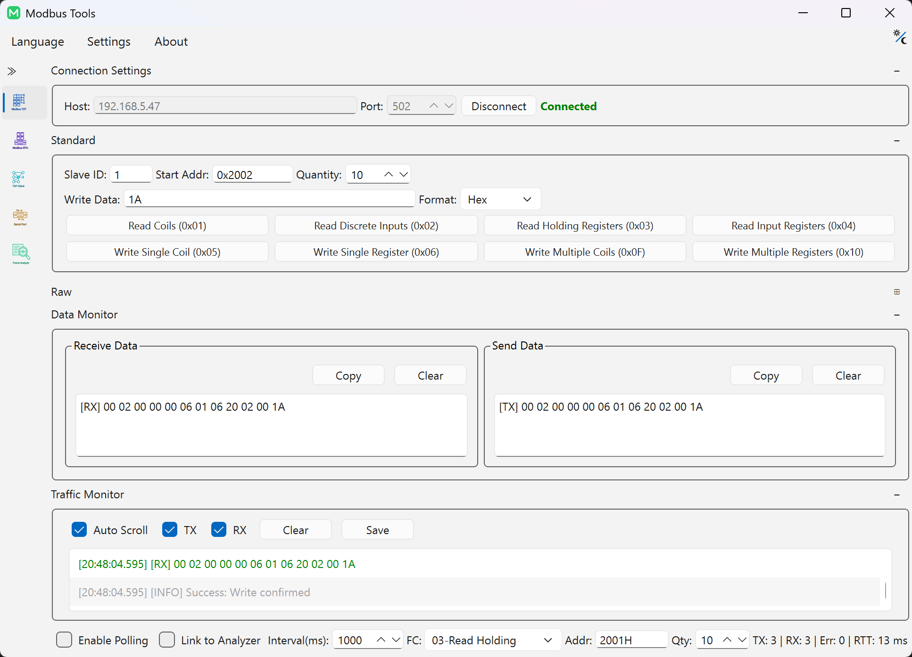
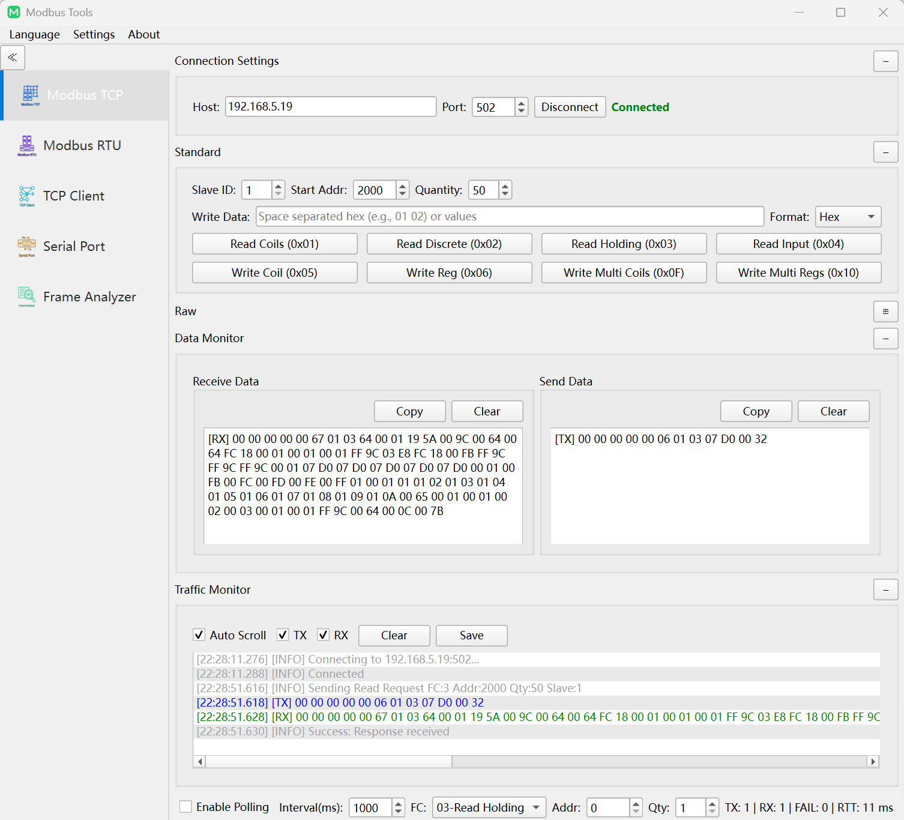
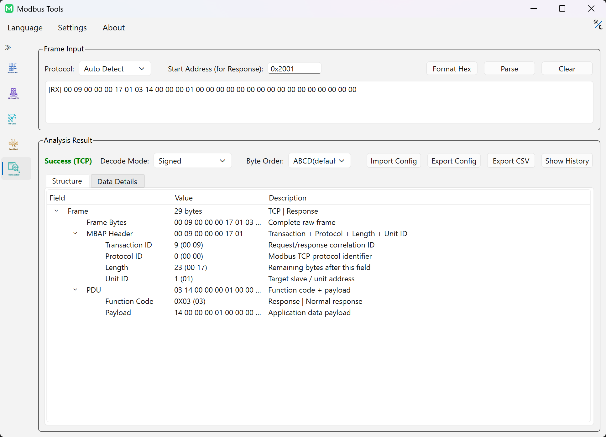
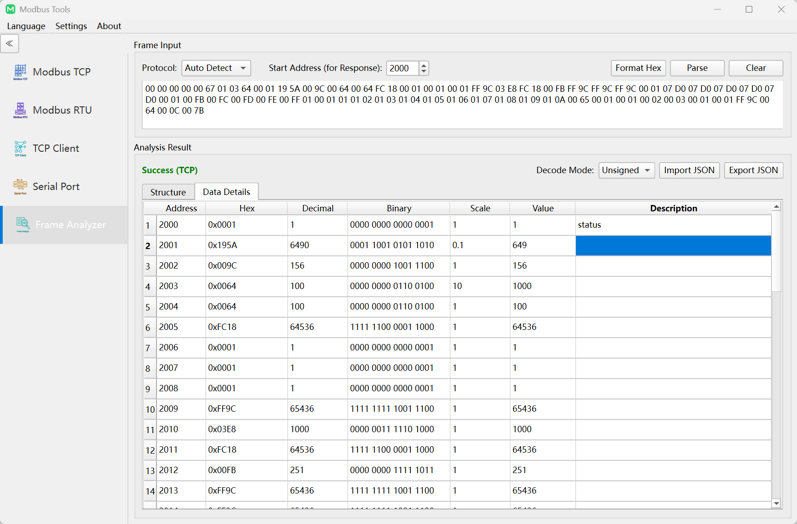

# Modbus-Tools User Guide

This guide details transport configuration, register reading/writing, frame parsing workflows, and system preferences.

---

## 1. Runtime Environment & Storage Model

`Modbus-Tools` operates as a portable application. All runtime artifacts are persisted directly adjacent to the executable:

- `config.ini`: User preferences, connection history, and UI state
- `logs/`: Diagnostic runtime logs (via spdlog)
- `update/`: Staging directory for transient update packages (native Windows updater)

> [!NOTE]
> **Multi-Instance Concurrency**: To monitor multiple serial lines or IP targets simultaneously, launch multiple application instances. Each instance is isolated via OS process boundaries. Concurrent instances share `config.ini` with last-write-wins semantics upon exit.

---

## 2. Transport Configuration

Three transport modes are supported within a unified interface:

| Transport | Default Parameters | Protocol Requirements & Timing Boundaries |
|:---|:---|:---|
| **Modbus TCP** | `127.0.0.1:502` | Standard Ethernet / Wi-Fi IP socket using a 7-byte MBAP header (transaction IDs and unit identifier) |
| **Modbus RTU** | 9600 baud, 8 data bits, None parity, 1 stop bit | RS-485 / RS-232 serial link strictly bounded by 3.5 character time (t3.5) inter-frame silent intervals and CRC16 checksums |
| **Modbus ASCII** | 9600 baud, 7 data bits, Even parity, 1 stop bit | 7-bit ASCII serial framing prefixed with `:` and terminated by `\r\n`, verified by LRC checksums |

---

## 3. Reading and Writing Registers & Coils

### Supported Function Codes
- **Bit Access (Discretes)**:
  - `0x01` Read Coils / `0x02` Read Discrete Inputs
  - `0x05` Write Single Coil / `0x0F` Write Multiple Coils
- **Register Access (Words)**:
  - `0x03` Read Holding Registers / `0x04` Read Input Registers
  - `0x06` Write Single Register / `0x10` Write Multiple Registers

### Input Value Syntax
- **Single Values**: Accepts Decimal (`1234`), Hexadecimal (`0x04D2`), or Binary (`0b0000010011010010`).
- **Batch Values**: Accepts space-separated integer or hex sequences (e.g., `0x1000 0x2000 4500`).

> [!WARNING]
> **Physical Equipment Safety**: Write commands directly actuate connected physical hardware. Verify target slave IDs, register addresses, and operational safety interlocks prior to dispatching write requests.

  

---

## 4. Cyclic Polling & Live Traffic Monitoring

- **Cyclic Polling**: Configurable execution interval (ms). Includes a consecutive communication error counter that triggers exponential backoff on link failures to prevent bus congestion.
- **Traffic Monitor**: Inspect live Rx/Tx frame streams with independent Tx/Rx filters, raw hex byte inspection, auto-scrolling, and log export.

---

## 5. Visual Frame Builder & Raw Frame Injection

`Modbus-Tools` decouples request composition from physical line transmission:

- **Visual Frame Builder (Converter View)**:
  - Assemble requests visually with automatic calculation of CRC16 (RTU), MBAP header (TCP), or LRC (ASCII).
  - Inspect structured protocol field decomposition and copy frames in multiple formats: spaced Hex, compact Hex, or C-array syntax (`uint8_t frame[] = {...};`).
  - Send assembled frames directly to the Frame Analyzer via "Inspect in Analyzer".
- **Physical Line Raw Injection (Modbus Session View)**:
  - To transmit raw arbitrary hex bytes directly onto the bus, switch to **Raw Data Mode** within the active Modbus session.

  

---

## 6. Frame Analyzer & Live Session Linkage

The **Frame Analyzer** decomposes raw hex byte streams into structured protocol objects:

- **Offline Analysis**: Paste any raw Hex string or ASCII frame (`:...`) to decompose Header, Function Code, Exception Codes, Payload, and Checksum fields via heuristic protocol detection or manual override.
- **Session Linkage**: Stream real-time responses from an active Modbus session directly into the analyzer with pause/resume support.
- **Capture History**: Preserves previous frames in a collapsible drawer for quick recall and comparison.

  

---

## 7. Register Decoding Grid & Byte Order Matrix

The analyzer translates payload bytes into typed register grids:

- **Supported Data Types**: `Int16`, `UInt16`, `Int32`, `UInt32`, `Float32`, `Float64`.
- **4-Way Byte Order Matrix**:
  - `ABCD`: Big-Endian (Motorola format, standard Modbus default)
  - `CDAB`: Word-Swapped (Mid-Little, widely used for 32-bit floats in Schneider / Modicon PLCs)
  - `BADC`: Byte-Swapped (Mid-Big)
  - `DCBA`: Total-Swapped Little-Endian (Intel format)
- **Batch Editing & Fast Reset**: Multi-select rows across strides to assign types; press `Delete` or `Backspace` to reset customized rows to default.
- **Scaling & Metadata**: Configure custom descriptions and numerical multiplier scales (`Scale`). Register configurations can be exported/imported via JSON; decoded grid records can be exported to CSV.

  

---

## 8. Standalone IEEE 754 Converter

Accessible from the Utilities menu:

- Bidirectional real-time conversion: Float32 / Float64 ⇄ Hexadecimal ⇄ Signed / Unsigned Integers.
- Edge-case detection: flags NaN, ±Infinity, and Denormalized values.
- Real-time conversion across all 4 byte order variants.

---

## 9. Generic Network & Serial Debuggers

Utility debuggers for low-level connection diagnostics:

- **TCP Client**: Test raw TCP connectivity and stream transmission.
- **TCP Server**: Listen on a local port, accept inbound client connections, and echo or inspect data.
- **UDP Debugger**: Bind sockets and transmit unicast or multicast datagrams.
- **Serial Debugger**: Connect to generic COM/TTY serial devices with raw Hex / ASCII logging and DTR/RTS control.

---

## 10. System Preferences

- **Language Switching**: Dynamically switch between English, Simplified Chinese (`简体中文`), and Traditional Chinese (`繁體中文`) without restarting.
- **Theme Selection**: Choose between Dark mode, Light mode, or System appearance follow.
