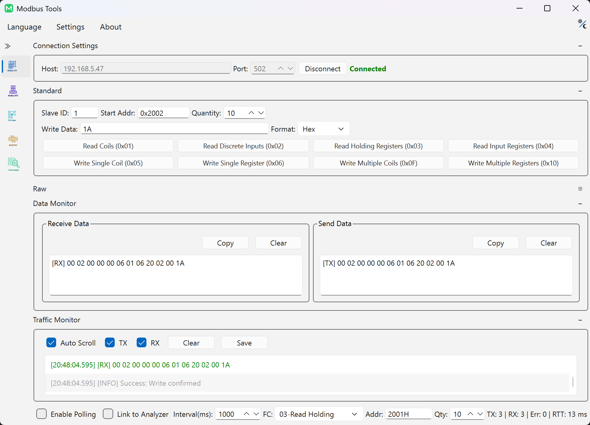
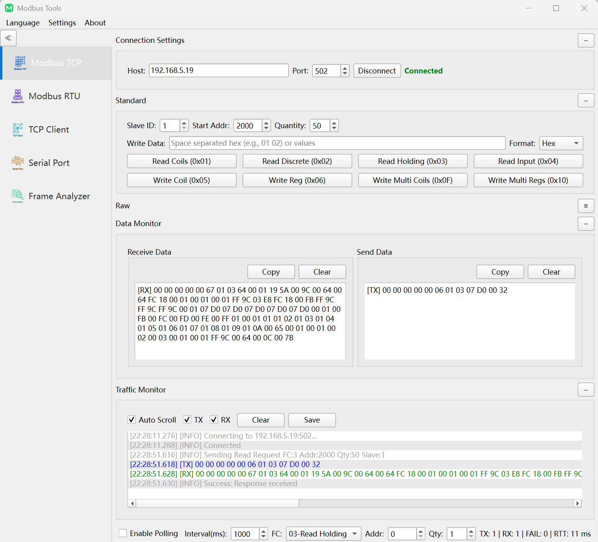
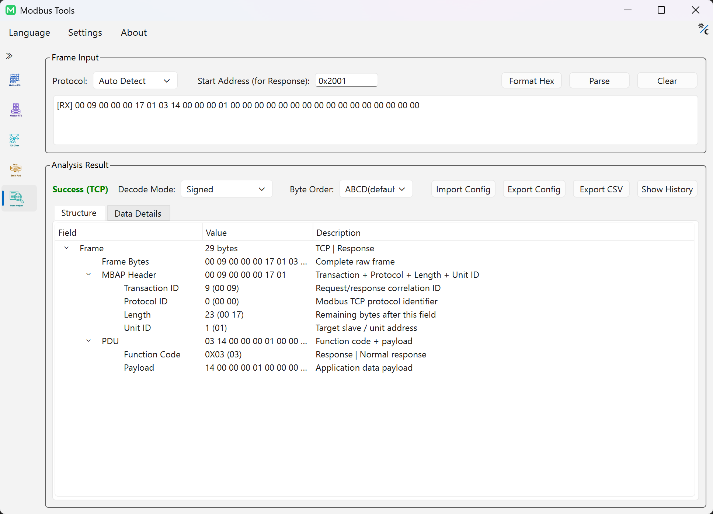
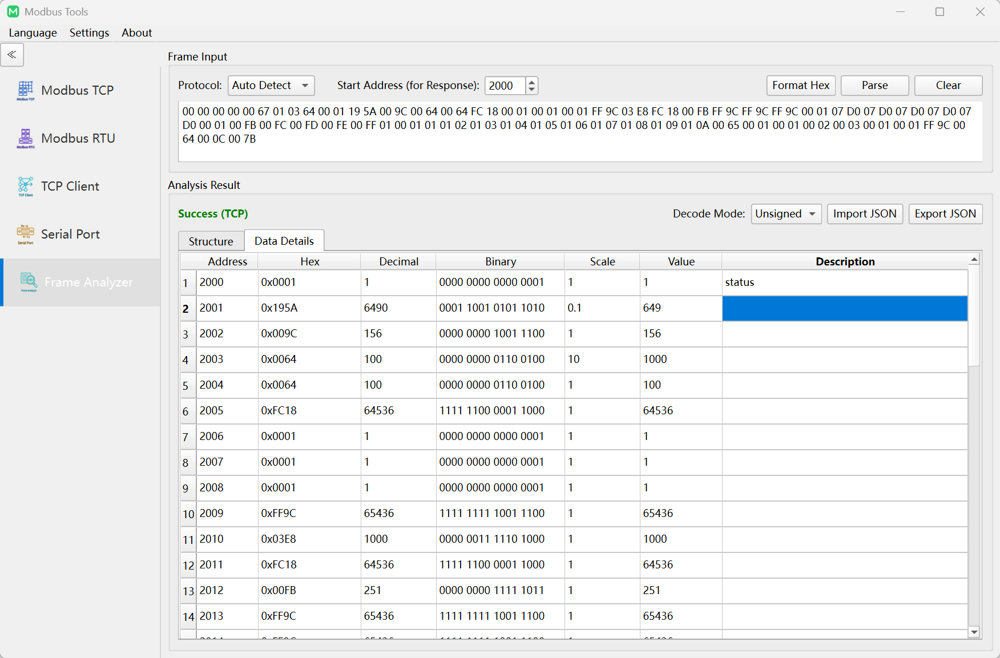

# Modbus-Tools 使用手册

本手册介绍通信链路配置、寄存器读写控制、报文解析流程与系统设置规范。

---

## 1. 运行环境与存储架构

`Modbus-Tools` 采用免安装便携设计，应用程序运行时产生的所有文件均持久化在可执行文件同级目录：

- `config.ini`：用户偏好设置、历史连接参数与界面状态
- `logs/`：运行时诊断日志（基于 spdlog）
- `update/`：增量更新暂存目录（Windows 原生更新组件）

> [!NOTE]
> **多实例并发排障**：若需同时监控多个物理串口或多台 PLC IP，直接启动多个应用程序进程即可。各实例通过操作系统进程边界完全隔离。多实例并发退出时，对共享 `config.ini` 遵循末尾覆盖机制（Last-Write-Wins）。

---

## 2. 通信链路配置

软件在统一界面中支持三种传输协议：

| 协议类型 | 默认配置 | 协议规范要求与时序特征 |
|:---|:---|:---|
| **Modbus TCP** | `127.0.0.1:502` | 基于标准以太网 / Wi-Fi IP 通信，采用 7 字节 MBAP 报文头（包含事务元数据与单元标识符） |
| **Modbus RTU** | 9600 波特率，8 数据位，无校验 (None)，1 停止位 | RS-485 / RS-232 串口链路，严格遵循 3.5 字符时间 (t3.5) 帧静默间隔判定与 CRC16 校验 |
| **Modbus ASCII** | 9600 波特率，7 数据位，偶校验 (Even)，1 停止位 | 7 位 ASCII 文本帧，采用冒号 (`:`) 起始与回车换行 (`\r\n`) 终结，校验采用 LRC |

---

## 3. 寄存器与线圈访问

### 支持的标准功能码
- **离散量（位操作）**：
  - `0x01` 读线圈 (Read Coils) / `0x02` 读离散输入 (Read Discrete Inputs)
  - `0x05` 写单线圈 (Write Single Coil) / `0x0F` 写多线圈 (Write Multiple Coils)
- **寄存器（字操作）**：
  - `0x03` 读保持寄存器 (Read Holding Registers) / `0x04` 读输入寄存器 (Read Input Registers)
  - `0x06` 写单寄存器 (Write Single Register) / `0x10` 写多寄存器 (Write Multiple Registers)

### 输入格式规范
- **单值写入**：支持十进制（如 `1234`）、十六进制（如 `0x04D2`）及二进制（如 `0b0000010011010010`）。
- **多值批量写入**：支持空格分隔的数值序列（例如 `0x1000 0x2000 4500`）。

> [!WARNING]
> **物理设备安全红线**：写线圈与写寄存器操作将直接下发指令控制现场物理受控端设备。下发写指令前，务必严格核对目标从站地址 (Slave ID)、寄存器起始地址与受控系统安全联锁状态，防止引发非预期设备动作。

  

---

## 4. 周期轮询与实时通信流量监控

- **周期性轮询**：支持配置轮询间隔（毫秒）。内置连续通信错误计数器，发生异常时自动执行阶梯式指数退避，避免无效重试导致总线拥堵。
- **流量监控器 (Traffic Monitor)**：实时呈现总线收发数据流，支持 Tx / Rx 独立显示过滤、十六进制原始字节视图、自动滚动与日志文件导出。

---

## 5. 可视化报文构造器与物理链路原始帧发送

`Modbus-Tools` 将离线请求编组与物理链路发送解耦：

- **可视化报文构造器（转换器页面）**：
  - 通过图形表单直观组装请求参数，自动计算并填充校验和：CRC16 (RTU)、MBAP 报文头 (TCP) 或 LRC (ASCII)。
  - 查看结构化协议字段分解，支持多格式导出复制：空格 Hex、紧凑 Hex、或 C 语言数组 (`uint8_t frame[] = {...};`)。
  - 支持通过“在分析器中检查”将构造报文一键推送到报文分析器。
- **物理链路原始帧发送（Modbus 会话视图）**：
  - 如需绕过协议组装逻辑直接向总线注入自定义原始十六进制字节，可在当前 Modbus 调试会话中切换至**原始数据模式 (Raw Data Mode)** 执行发送。

  

---

## 6. 报文分析器与实时会话联动

**报文分析器 (Frame Analyzer)** 负责将底层十六进制原始字节帧解构为结构化协议对象：

- **离线解析**：粘贴任意十六进制字符串或 ASCII 文本帧（`:...`），系统支持协议启发式自动推断或手动切换，解构报头、功能码、异常码、数据载荷与校验位。
- **活动会话联动**：支持将主界面活动调试会话中收到的响应一键推送至分析器，并支持实时捕获的暂停与继续。
- **历史记录管理**：历史解析记录保存在可折叠侧边栏抽屉中，支持快速回溯与清空。

  

---

## 7. 寄存器解码网格与字节序矩阵

分析器将载荷字节解码为强类型寄存器数值网格：

- **支持数据类型**：`Int16`、`UInt16`、`Int32`、`UInt32`、`Float32`、`Float64`。
- **4 种标准字节序矩阵**：
  - `ABCD`：标准大端 (Big-Endian / Motorola 格式，Modbus 标准默认)
  - `CDAB`：字交换大端 (Word-Swapped / Mid-Little，广泛用于 Schneider、Modicon 等 PLC 32 位浮点数)
  - `BADC`：字节交换 (Byte-Swapped / Mid-Big)
  - `DCBA`：全字节交换小端 (Little-Endian / Intel 格式)
- **批量设置与快捷重置**：支持跨步多选行批量赋予数据类型；按 `Delete` 或 `Backspace` 可重置选定行为默认类型。
- **缩放系数与描述元数据**：支持为寄存器配置乘法缩放系数 (`Scale`) 及功能描述。寄存器映射配置支持通过 JSON 导入导出；解析后的数据表格支持导出为 CSV 报表。

  

---

## 8. 独立 IEEE 754 浮点数转换器

位于工具箱导航中，提供高精度的数值换算辅助：

- **双向即时换算**：Float32 / Float64 ⇄ 十六进制字节 ⇄ 有符号 / 无符号整型。
- **浮点特殊边界识别**：自动标注非数 (NaN)、正负无穷大 (±Infinity) 与非规格化数 (Denormalized)。
- **字节序联动**：实时展示全部 4 种字节序下的变换结果，加速现场固件通信协议对比排障。

---

## 9. 底层通用网络与串口调试工具

除 Modbus 协议栈外，内置底层通信排障工具：

- **TCP 客户端**：测试通用 TCP 服务端网络连通性与双向数据流收发。
- **TCP 服务端**：监听本地指定端口，接收外部客户端连接并提供数据回显或校验。
- **UDP 调试器**：支持单播/多播数据报绑定、发送与接收测试。
- **串口调试器**：直连任意 COM/TTY 串口，进行原始 Hex / ASCII 数据交互与 DTR/RTS 引脚控制。

---

## 10. 系统偏好设置

- **语言切换**：支持英文 (English)、简体中文与繁体中文即时切换，无须重启应用。
- **外观主题**：支持深色模式 (Dark)、浅色模式 (Light) 或跟随操作系统外观。
