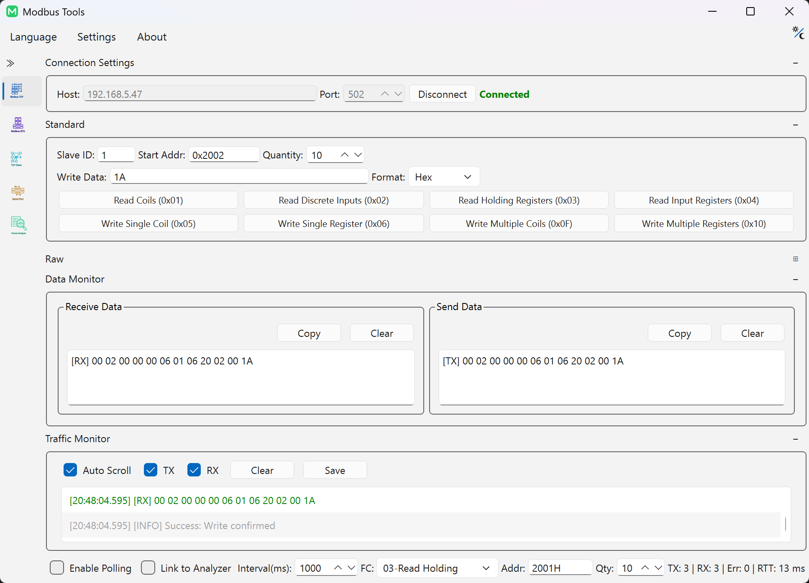
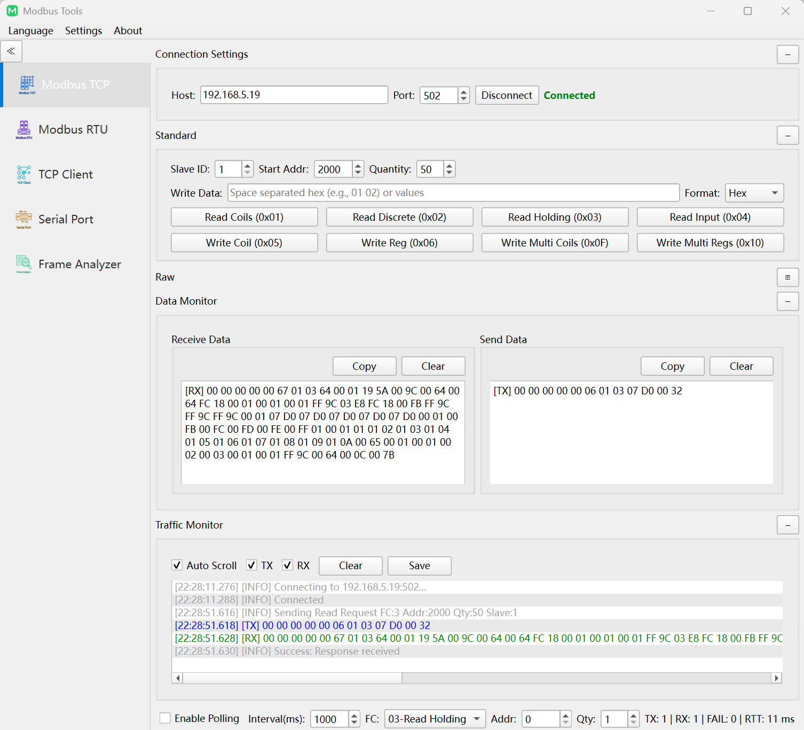
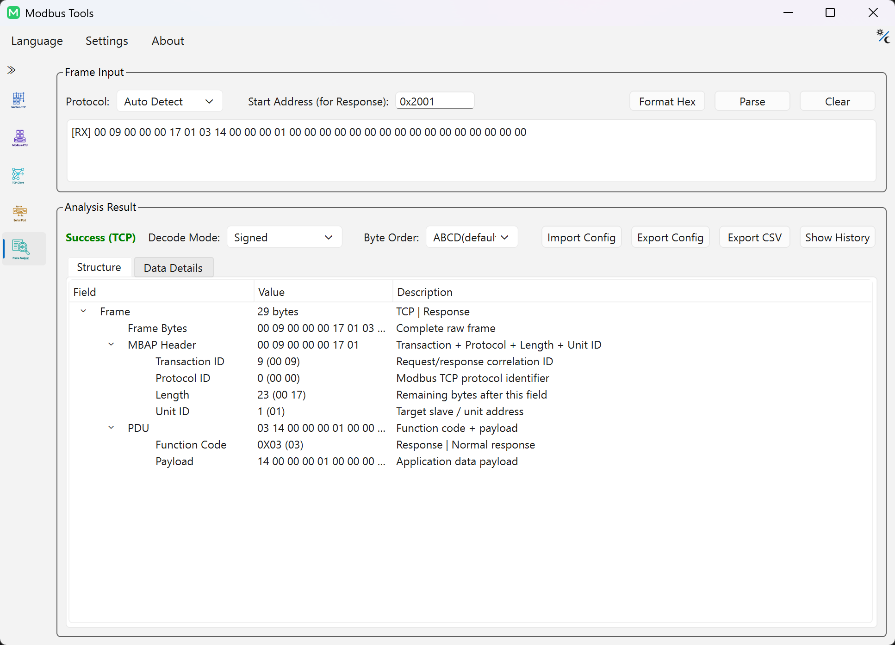
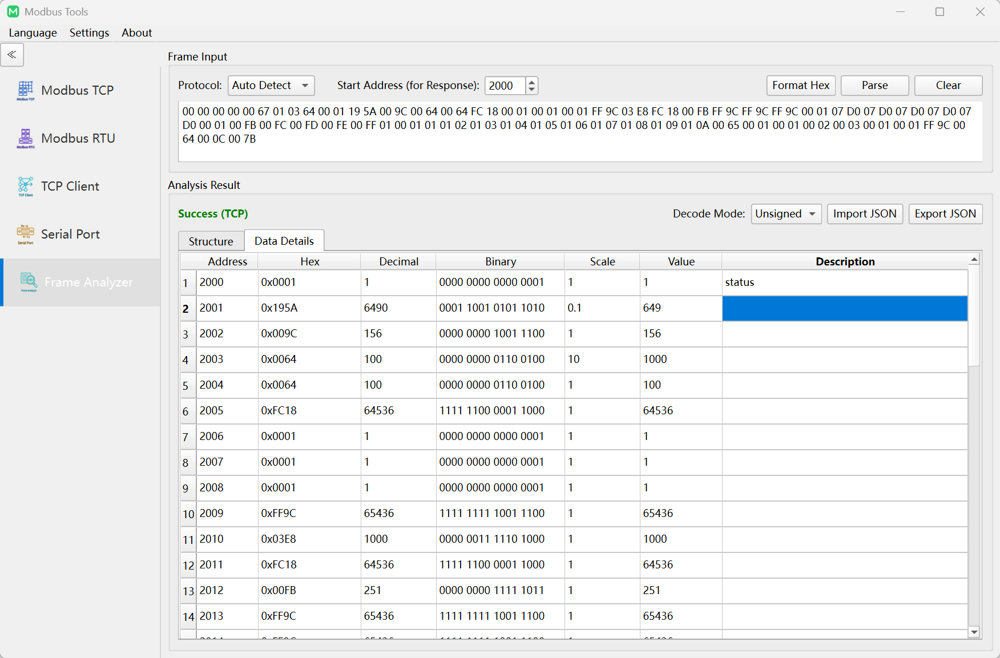

# Modbus-Tools 使用手冊

本手冊介紹通訊鏈路設定、暫存器讀寫控制、訊框解析流程與系統設定規範。

---

## 1. 執行環境與儲存架構

`Modbus-Tools` 採用免安裝便攜設計，應用程式執行階段產生的所有檔案均持久化於可執行檔同級目錄：

- `config.ini`：使用者偏好設定、歷史連線參數與介面狀態
- `logs/`：執行階段診斷日誌（基於 spdlog）
- `update/`：增量更新暫存目錄（Windows 原生更新元件）

> [!NOTE]
> **多執行個體並行排障**：若需同時監控多個實體序列埠或多台 PLC IP，直接啟動多個應用程式處理程序即可。各執行個體透過作業系統處理程序邊界完全隔離。多個執行個體並行結束時，對共享 `config.ini` 依循末尾覆寫機制（Last-Write-Wins）。

---

## 2. 通訊鏈路設定

軟體在統一介面中支援三種傳輸協定：

| 協定類型 | 預設設定 | 通訊協定規範要求與時序特徵 |
|:---|:---|:---|
| **Modbus TCP** | `127.0.0.1:502` | 基於標準乙太網路 / Wi-Fi IP 通訊，採用 7 位元組 MBAP 標頭（包含交易識別碼與單元識別元） |
| **Modbus RTU** | 9600 鮑率，8 資料位元，無校驗 (None)，1 停止位元 | RS-485 / RS-232 序列埠鏈路，嚴格依循 3.5 字元時間 (t3.5) 訊框靜默間隔判定與 CRC16 校驗 |
| **Modbus ASCII** | 9600 鮑率，7 資料位元，偶校驗 (Even)，1 停止位元 | 7 位元 ASCII 文字訊框，採用冒號 (`:`) 起始與歸位換行 (`\r\n`) 結尾，校驗採用 LRC |

---

## 3. 暫存器與線圈存取

### 支援的標準功能碼
- **離散量（位元操作）**：
  - `0x01` 讀線圈 (Read Coils) / `0x02` 讀離散輸入 (Read Discrete Inputs)
  - `0x05` 寫單線圈 (Write Single Coil) / `0x0F` 寫多線圈 (Write Multiple Coils)
- **暫存器（字組操作）**：
  - `0x03` 讀保持暫存器 (Read Holding Registers) / `0x04` 讀輸入暫存器 (Read Input Registers)
  - `0x06` 寫單暫存器 (Write Single Register) / `0x10` 寫多暫存器 (Write Multiple Registers)

### 輸入格式規範
- **單值寫入**：支援十進位（如 `1234`）、十六進位（如 `0x04D2`）及二進位（如 `0b0000010011010010`）。
- **多值批次寫入**：支援空格分隔的數值序列（例如 `0x1000 0x2000 4500`）。

> [!WARNING]
> **實體設備安全紅線**：寫線圈與寫暫存器操作將直接下發指令控制現場實體受控端設備。下發寫指令前，務必嚴格核對目標從站位址 (Slave ID)、暫存器起始位址與受控系統安全連鎖狀態，防止引發非預期設備動作。

  

---

## 4. 週期輪詢與即時通訊流量監控

- **週期性輪詢**：支援設定輪詢間隔（毫秒）。內建連續通訊錯誤計數器，發生異常時自動執行階梯式指數退避，避免無效重試導致匯流排壅塞。
- **流量監控器 (Traffic Monitor)**：即時呈現匯流排收發資料串流，支援 Tx / Rx 獨立顯示篩選、十六進位原始位元組檢視、自動捲動與日誌檔案匯出。

---

## 5. 視覺化報文建構器與實體鏈路原始訊框傳送

`Modbus-Tools` 將離線請求編組與實體鏈路傳送解耦：

- **視覺化報文建構器（轉換器頁面）**：
  - 透過圖形表單直觀組裝請求參數，自動計算並填入校驗和：CRC16 (RTU)、MBAP 標頭 (TCP) 或 LRC (ASCII)。
  - 檢視結構化通訊協定欄位分解，支援多格式匯出複製：空格 Hex、緊湊 Hex、或 C 語言陣列 (`uint8_t frame[] = {...};`)。
  - 支援透過「在分析器中檢查」將建構的訊框一鍵推送到協定分析器。
- **實體鏈路原始訊框傳送（Modbus 工作階段檢視）**：
  - 如需繞過協定組裝邏輯直接向匯流排注入自訂原始十六進位位元組，可在目前 Modbus 調試工作階段中切換至**原始資料模式 (Raw Data Mode)** 執行傳送。

  

---

## 6. 協定分析器與即時工作階段連動

**協定分析器 (Frame Analyzer)** 負責將底層十六進位原始位元組訊框解構為結構化協定物件：

- **離線解析**：貼上任意十六進位字串或 ASCII 文字訊框（`:...`），系統支援協定啟發式自動推斷或手動切換，解構標頭、功能碼、異常碼、資料負載與校驗位。
- **活動工作階段連動**：支援將主介面活動調試工作階段中收到的回應一鍵推送到分析器，並支援即時擷取的暫停與繼續。
- **歷史記錄管理**：歷史解析記錄保存在可折疊側邊欄抽屜中，支援快速回溯與清空。

  

---

## 7. 暫存器解碼表格與位元組序矩陣

分析器將負載位元組解碼為強型態暫存器數值表格：

- **支援資料型態**：`Int16`、`UInt16`、`Int32`、`UInt32`、`Float32`、`Float64`。
- **4 種標準位元組序矩陣**：
  - `ABCD`：標準大端 (Big-Endian / Motorola 格式，Modbus 標準預設)
  - `CDAB`：字交換大端 (Word-Swapped / Mid-Little，廣泛用於 Schneider、Modicon 等 PLC 32 位元浮點數)
  - `BADC`：位元組交換 (Byte-Swapped / Mid-Big)
  - `DCBA`：全位元組交換小端 (Little-Endian / Intel 格式)
- **批次設定與快捷重設**：支援跨步多選列批次賦予資料型態；按 `Delete` 或 `Backspace` 可重設選定列為預設型態。
- **縮放係數與描述元資料**：支援為暫存器設定乘法縮放係數 (`Scale`) 及功能描述。暫存器對應設定支援透過 JSON 匯入匯出；解析後的資料表格支援匯出為 CSV 報表。

  

---

## 8. 獨立 IEEE 754 浮點數轉換器

位於工具箱導覽中，提供高精度的數值換算輔助：

- **雙向即時換算**：Float32 / Float64 ⇄ 十六進位位元組 ⇄ 有符號 / 無符號整數。
- **浮點特殊邊界識別**：自動標註非數 (NaN)、正負無限大 (±Infinity) 與非正規化數 (Denormalized)。
- **位元組序連動**：即時展示全部 4 種位元組序下的轉換結果，加速現場韌體通訊協定比對排障。

---

## 9. 底層通用網路與序列埠調試工具

除 Modbus 協定堆疊外，內建底層通訊排障工具：

- **TCP 用戶端**：測試通用 TCP 伺服端網路連通性與雙向資料流收發。
- **TCP 伺服端**：接聽本機指定連接埠，接收外部用戶端連線並提供資料回顯或校驗。
- **UDP 調試器**：支援單播/多播資料包繫結、傳送與接收測試。
- **序列埠調試器**：直連任意 COM/TTY 序列埠，進行原始 Hex / ASCII 資料互動與 DTR/RTS 針腳控制。

---

## 10. 系統偏好設定

- **語言切換**：支援英文 (English)、簡體中文與繁體中文即時切換，無須重新啟動應用程式。
- **外觀主題**：支援深色模式 (Dark)、淺色模式 (Light) 或跟隨作業系統外觀。
